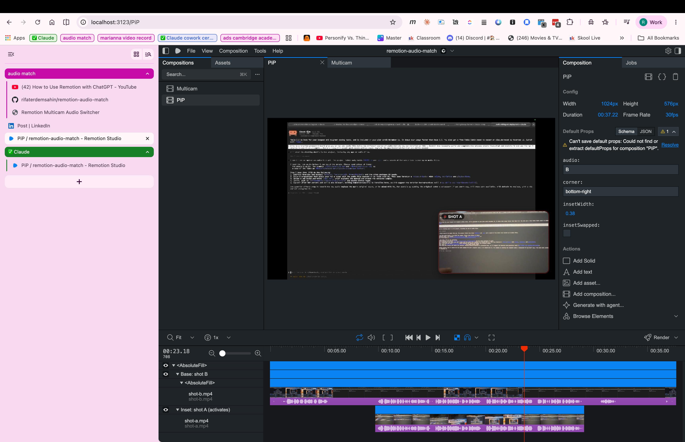

# remotion-audio-match

**▶ Live demo (GitHub Pages): https://rifaterdemsahin.github.io/remotion-audio-match/**

Two recordings of the same event, lined up **inside Remotion** by their shared audio, shown as
picture-in-picture (the short shot activates inside the long one) or as a cut list where you pick the shot and the audio.



## Run it
```bash
npm install
npm run studio        # Remotion Studio: compositions PiP and Multicam, with the timeline
npm run render:pip    # export out/pip.mp4   (npm run render -> out/multicam.mp4)
npm run dev           # web preview        · npm run build -> docs/ (GitHub Pages)
```

## How the line-up was done (two tactics, cross-checked)
| Tactic | Command | Result |
|---|---|---|
| Transcription (local Whisper word timestamps, shared-word voting) | `npm run sync:transcript` | −9.78 s (±0.25) |
| Waveform cross-correlation + 2 s windowed drift check | `npm run sync:waveform`, `npm run sync:verify` | −9.782 s, 18/18 windows, ±1 ms |

Result: **B started 9.78 s before A** (−293 frames @30fps), stored in `src/lib/sync.ts`.

## Layout (pattern: lowercase kebab-case, `{kind}-{id}`)
```
public/video/shot-{id}.mp4        data/transcripts/shot-{id}.json
scripts/sync-{transcript|waveform|verify}.mjs
src/lib/{sync,timeline}.ts        src/compositions/{Root,Multicam,PiP}.tsx     src/web/main.tsx
prompts/line-up-shots.md          CLAUDE.md          index.html -> docs/
```
See [`CLAUDE.md`](CLAUDE.md) for conventions and gotchas.

## Prompt for next time
The full reusable prompt (goal, dependencies, both tactics, rules, verification, delivery) is in
[`prompts/line-up-shots.md`](https://github.com/rifaterdemsahin/remotion-audio-match/blob/main/prompts/line-up-shots.md) 📋 and on the live page with a **Copy prompt** button.
